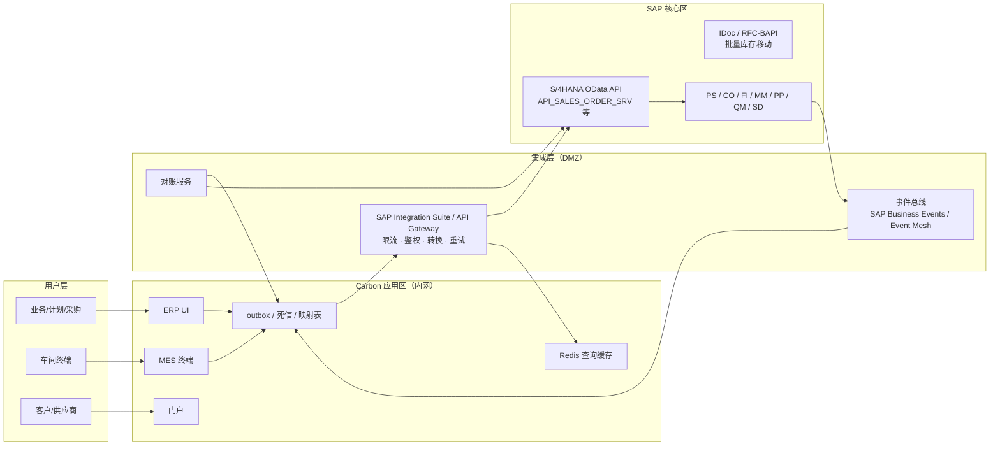
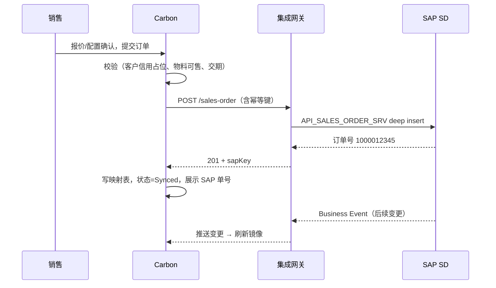
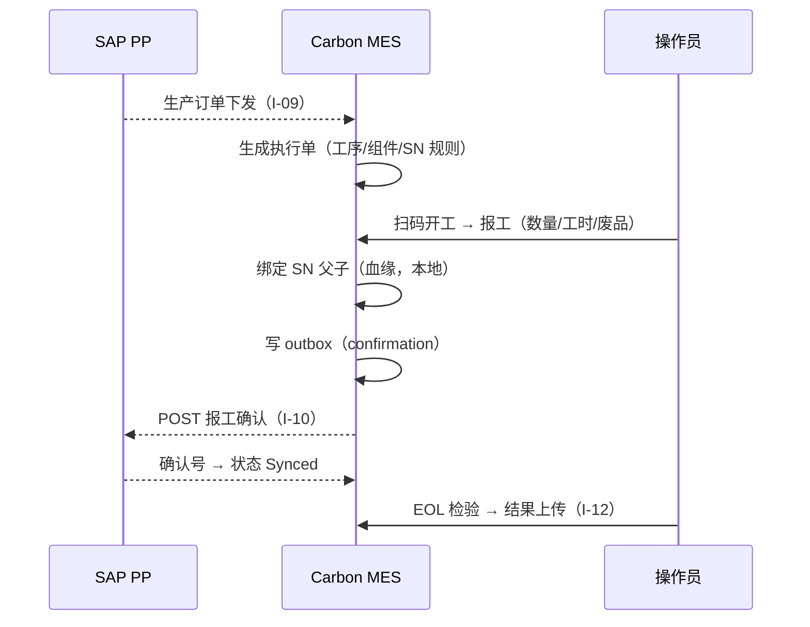
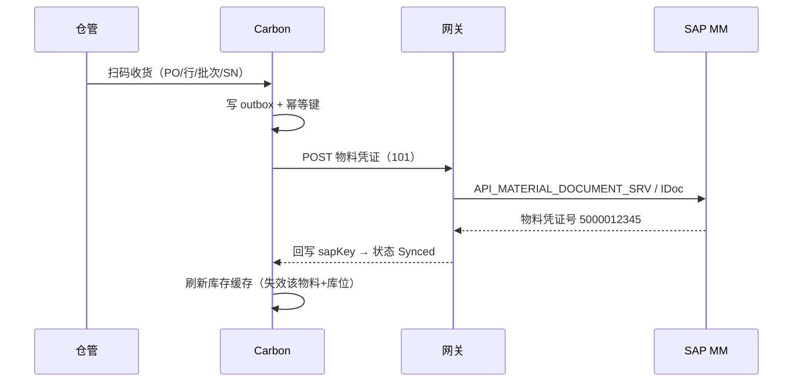
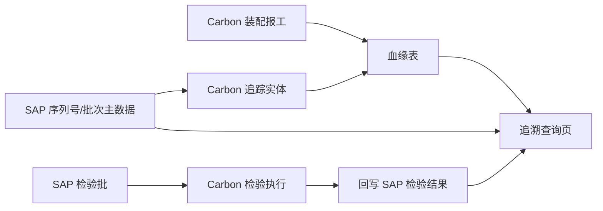

# Carbon（前台）+ SAP（后台）· SAP 集成版蓝图

> **前提**：企业已有 SAP 作为核心 ERP（下文按 **S/4HANA + API-first** 写，ECC 差异在 §10 标注）；Carbon 承担"面向业务的界面与执行层"，SAP 承担"核心业务逻辑与账"。
> **一句话**：这不是"两套 ERP 并联"，而是 **SoE（Engagement）＋ SoR（Record）** 的分工——**每个单据只能有一个状态机主人**，另一侧只读镜像。
> **配套文档**：[储能系统集成-数字化蓝图方案.md](储能系统集成-数字化蓝图方案.md)（业务蓝图）、[carbon-蓝图方案.md](carbon-蓝图方案.md)（Carbon 逆向）。

---

## 1. 定位与四条铁律

| 层 | 系统 | 职责 |
| --- | --- | --- |
| **SoE 前台** | Carbon | 报价/方案配置、项目执行视图、车间执行、质量采集、SN 装配关系、现场服务、客户门户 |
| **SoR 后台** | SAP | 主数据、销售订单、采购订单、库存与估值、生产订单、成本与总账、开票、合规 |

**四条铁律**（写进架构评审 checklist，违反即驳回）：

1. **单一状态机**：同一业务对象（销售订单/采购订单/生产订单/库存/发票）只有一方能改状态，另一方只读镜像 + 展示 SAP 状态。
2. **单一账本**：库存数量与金额只在 SAP；Carbon 永不计库存账、永不做成本结转。
3. **单一主数据源**：物料/客户/供应商/工厂/库位/工作中心以 SAP 为准，Carbon 只读；Carbon 需要新物料走"申请单"回 SAP 建。
4. **写操作必带幂等键，失败必进死信**：Carbon 的写是对 SAP 的"请求"，不是"事实"。

> 最常见的失败模式：Carbon 里显示"已发货"，SAP 里没过账；或者两边都能改工单状态。这两件事一旦发生，蓝图就废了。

---

## 2. 职责矩阵（谁拥有什么）

| 业务对象 / 域 | 状态主人 | 数据主人 | Carbon 的角色 | 集成方向 |
| --- | --- | --- | --- | --- |
| 物料主数据（含 UoM、工厂视图） | SAP | SAP | 只读 + 搜索 | SAP → Carbon（增量） |
| 客户 / 供应商（BP） | SAP | SAP | 只读 + 快捷建档申请 | SAP → Carbon；申请 Carbon → SAP |
| BOM（工程 EBOM / 项目配置） | **Carbon** | **Carbon** | 拥有 + 版本 + 发布 | Carbon → SAP（发布 MBOM/组件） |
| 工艺路线 / 生产版本 | SAP | SAP | 只读展示 | SAP → Carbon |
| 报价 / 方案配置 | Carbon | Carbon | 拥有 | 报价结果 → SAP（销售订单） |
| 销售订单 | **SAP** | SAP | 创建/变更请求、状态镜像 | Carbon → SAP；状态 SAP → Carbon |
| 项目 / WBS / 里程碑 | **SAP PS** | SAP | 展示 + 执行反馈 | SAP → Carbon；进度 Carbon → SAP |
| 采购申请 / 采购订单 | **SAP** | SAP | 申请与跟单视图 | Carbon → SAP；状态回传 |
| 收货 / 库存移动 | **SAP** | SAP | 发起移动请求（带单据与 SN） | Carbon → SAP（同步/异步） |
| 库存余额 / 库龄 / 估值 | SAP | SAP | 只读（缓存 30–60s） | SAP → Carbon |
| 生产订单 | **SAP** | SAP | 执行单（工序级作业） | SAP → Carbon；完工确认 Carbon → SAP |
| 报工 / 工时 / 废品 | **Carbon 采集 → SAP 过账** | 分摊：明细 Carbon，汇总 SAP | 采集 + 回传确认 | Carbon → SAP（confirmation） |
| 检验批 / 检验结果 | 分摊：SAP 建批，Carbon 采集 | 结果 Carbon，判定 SAP | 采集测量值 + 上传 | SAP → Carbon（检验批）；Carbon → SAP（结果） |
| SN / 批次主数据 | **SAP** | SAP | 只读 + 打码 | SAP → Carbon |
| SN 装配血缘（父子） | **Carbon** | **Carbon** | 拥有 | 供追溯查询；关键节点回传 SAP |
| 不合格品 / NCR | Carbon（执行）→ SAP（库存处置） | 分摊 | 拥有处置流程 | Carbon → SAP（报废/退库移动） |
| 发运 / 交货单 | **SAP** | SAP | 装箱与标签执行 | Carbon → SAP（包装信息）；SAP → Carbon（交货单） |
| 发票 / 应收应付 | **SAP** | SAP | 开票申请 + 状态展示 | Carbon → SAP；SAP → Carbon |
| 成本 / 总账 | **SAP CO/FI** | SAP | 只读展示（项目毛利取 SAP） | SAP → Carbon（汇总） |
| 质保 / 装机台账 / 现场服务 | **Carbon** | Carbon | 拥有（SAP 无对应或很弱） | 关键财务影响回传 SAP（服务成本） |
| 权限（业务授权） | SAP | SAP | UI 层角色（取交集） | SSO + 角色映射 |

**结论**：Carbon 拥有的是 **EBOM/配置、执行明细、SN 血缘、售后**；SAP 拥有的是 **订单、库存、成本、账**。这与"把 Carbon 当前台"的目标一致——前台的价值在"执行与体验"，不在"记账"。

---

## 3. 集成架构



**三条通道，各司其职**：

| 通道 | 用途 | 典型对象 | 特点 |
| --- | --- | --- | --- |
| A. 同步查询（OData GET） | 前台读：物料、库存、订单状态、成本 | `API_PRODUCT_SRV`、`API_MATERIAL_STOCK_SRV` | 必须加缓存与超时降级 |
| B. 同步写（OData POST / BAPI） | 少量、需即时结果：销售订单、生产订单确认 | `API_SALES_ORDER_SRV`、`API_PRODORDER_CONFIRMATION` | 2s 内返回，否则转异步 |
| C. 异步批量（IDoc / 队列） | 大批量、可延迟：库存移动、收货、发票 | `MB_MIGO_BADI`/IDoc `WMMBID02`、`INVOICE` | 幂等 + 对账，不阻塞 UI |

**禁止**：Carbon 直连 SAP 数据库（RFC 直连也只允许经由网关）；SAP 侧不直接调用 Carbon 的私有接口，只走网关或事件。

---

## 4. 接口清单（可执行版）

| # | 对象 | 方向 | SAP 接口 | 触发 | 幂等键 | SLA |
| --- | --- | --- | --- | --- | --- | --- |
| I-01 | 物料主数据 | SAP→C | `API_PRODUCT_SRV`（增量 `LastChangedAt`） | 定时 15min + 手动 | `materialNumber` | 15min |
| I-02 | 客户/供应商 | SAP→C | `API_BUSINESS_PARTNER` | 定时 15min | `bpId` | 15min |
| I-03 | 工厂/库位/工作中心 | SAP→C | `API_PLANT`/`API_STORAGELOCATION`/`API_WORKCENTER` | 每日 | `id` | 1d |
| I-04 | 库存余额 | SAP→C | `API_MATERIAL_STOCK_SRV` | 查询时（缓存 60s） | — | 800ms |
| I-05 | 销售订单创建 | C→SAP | `API_SALES_ORDER_SRV`（deep insert） | 用户提交 | `carbon:SO:{id}:v{n}` | 2s 或转异步 |
| I-06 | 销售订单状态 | SAP→C | `API_SALES_ORDER_SRV` / Business Event `SalesOrder.Changed` | 事件或 5min 轮询 | `soNumber` | 5min |
| I-07 | 采购申请/订单 | C→SAP | `API_PURCHASEREQUISITION`/`API_PURCHASEORDER_PROCESS_SRV` | 用户提交 | `carbon:PR:{id}` | 2s |
| I-08 | 收货 / 库存移动 | C→SAP | `API_MATERIAL_DOCUMENT_SRV`（或 IDoc `WMMBID02`） | 扫码提交 | `carbon:MVT:{id}` | 5s / 批量 15min |
| I-09 | 生产订单下发 | SAP→C | `API_PRODUCTION_ORDER_2_SRV` | 事件/5min | `prodOrder` | 5min |
| I-10 | 报工确认 | C→SAP | `API_PRODORDER_CONFIRMATION`（BAPI `BAPI_PRODORDCONF_CREATE_TT`） | 工序完成 | `carbon:CONF:{opId}:{seq}` | 5s |
| I-11 | 检验批 | SAP→C | `API_INSPECTIONLOT_SRV` | 事件/轮询 | `inspectionLot` | 15min |
| I-12 | 检验结果 | C→SAP | `API_INSPECTIONRESULT_SRV`（或 QM IDoc） | 检验完成 | `carbon:IR:{lotId}:{char}` | 15min |
| I-13 | 序列号主数据 | SAP→C | `API_SERIALNUMBER`（或自定义 CDS） | 收货/生产入库后 | `serialNumber` | 15min |
| I-14 | 交货单 | SAP→C | `API_OUTBOUND_DELIVERY_SRV` | 事件 | `deliveryNumber` | 5min |
| I-15 | 开票申请 | C→SAP | `API_BILLING_DOCUMENT_SRV`（或 SD 开票请求） | 里程碑/发货 | `carbon:INVREQ:{id}` | 异步 |
| I-16 | 项目 WBS/里程碑 | SAP→C | `API_PROJECTDEFINITION_SRV` / PS BAPI | 每日 + 事件 | `wbsElement` | 1d |
| I-17 | 项目成本汇总 | SAP→C | CO 报表 CDS / `API_*COST*` | 每日 | `wbs+period` | 1d |
| I-18 | 供应商发票 | SAP→C | `API_SUPPLIERINVOICE_PROCESS_SRV` | 事件 | `invoiceNumber` | 1d |

> 具体 API 名称随 SAP 版本差异，落地前用 `/IWFND/MAINT_SERVICE` 或 API Hub 核对并锁版本；接口清单要进 **接口契约仓库**（OpenAPI/IDoc 结构 + 样例报文）。

---

## 5. 主数据与 ID 治理

### 5.1 双 ID 与映射表

Carbon 用短 ID（`xid`），SAP 用业务编号。**必须建一张映射表**，所有跨系统操作只认映射：

```sql
CREATE TABLE "sapObjectMap" (
  id text PRIMARY KEY DEFAULT xid(),
  "companyId" text NOT NULL,
  "objectType" text NOT NULL,            -- material/customer/so/po/prodOrder/serial...
  "carbonId"   text NOT NULL,
  "sapKey"     text NOT NULL,            -- SAP 业务编号（保留前导零）
  "sapSystem"  text NOT NULL,            -- 系统标识（多客户端/多公司码）
  "validFrom"  timestamptz NOT NULL DEFAULT now(),
  "validTo"    timestamptz,
  UNIQUE ("companyId","objectType","carbonId","sapSystem","validFrom")
);
CREATE INDEX ON "sapObjectMap" ("objectType","sapKey");
```

### 5.2 SAP 特有的坑（必须在映射层处理）

| 坑 | 处理 |
| --- | --- |
| 前导零 | 物料号/客户号统一 `padStart(18,'0')` 存储，展示去零 |
| 单位双码 | SAP 内部 UoM（如 `ST`）× ISO 码（`PCE`）→ 映射表 + 换算因子 |
| 金额精度 | SAP packed decimal → 统一 `numeric(19,6)` 传输，禁止 float |
| 日期格式 | SAP OData `/Date(1731000000000)/` → 统一 ISO8601 |
| 时区 | 单据日期（SAP 系统时区）与过账日期分离，Carbon 展示要标注 |
| 多公司码/多工厂 | 每条报文必须带 `companyCode`/`plant`，Carbon 侧做"公司→工厂"映射 |
| 删除/冻结 | SAP 的 deletion flag 不是物理删除，Carbon 只做"不可选"，不删历史 |

---

## 6. 交互模式与一致性

### 6.1 三种模式

| 模式 | 适用 | 机制 | UX |
| --- | --- | --- | --- |
| **查（Cache-Aside）** | 物料、库存、订单状态 | Carbon 读 Redis（TTL 30–60s），miss 才调 SAP；带 `stale-while-revalidate` | 首屏快；显示"数据截至 HH:mm" |
| **写（Outbox + 状态机）** | 报工、移动、开票申请 | Carbon 本地事务写 outbox → 异步调 SAP → 回写 `Pending/Synced/Failed` | 提交即成功（本地），角标显示同步状态 |
| **强一致（Write-Through）** | 销售订单创建、生产订单确认 | 同步调 SAP，2s 超时；超时转 Outbox 并提示 | 显示 SAP 单号或"处理中" |

### 6.2 outbox 表（Carbon 侧）

```sql
CREATE TABLE "sapOutbox" (
  id text PRIMARY KEY DEFAULT xid(),
  "objectType" text NOT NULL,
  "carbonId" text NOT NULL,
  "idempotencyKey" text NOT NULL UNIQUE,
  payload jsonb NOT NULL,            -- 已转换为 SAP 契约
  status text NOT NULL DEFAULT 'Pending',  -- Pending/Sending/Synced/Failed/Dead
  attempts int NOT NULL DEFAULT 0,
  "sapKey" text,
  "lastError" text,
  "nextAttemptAt" timestamptz,
  "createdAt" timestamptz NOT NULL DEFAULT now()
);
```

### 6.3 对账（没有对账就没有集成）

- **日对账**：按对象比对（Carbon 已提交 vs SAP 已存在），差异入 `reconDiff` 表，责任到人。
- **状态对账**：SAP 侧单据状态变化必须能反向刷新 Carbon（事件优先，轮询兜底）。
- **金额对账**：开票/收货金额与 SAP 凭证的差异，月度由财务签字。

### 6.4 失败处理

| 场景 | 处理 |
| --- | --- |
| SAP 返回 4xx（业务拒绝） | 不重试，标记 `Failed`，UI 展示 SAP 原始错误码与中文解释 |
| SAP 超时 / 5xx / 限流 | 指数退避重试（1s→2s→…→5min，上限 10 次），仍失败进 `Dead` |
| 死信 | 运维页可"查看/编辑/重放"，重放走同一幂等键 |
| SAP 长时间不可用 | Carbon 进入"只读 + 排队"模式，禁止新建跨系统单据，页面顶部横幅提示 |

---

## 7. 四个关键场景时序

### 7.1 销售订单：Carbon 报价 → SAP 订单



### 7.2 车间执行：SAP 生产订单 → Carbon 执行 → 回传确认



### 7.3 收货与库存移动：Carbon 发起，SAP 记账



### 7.4 项目成本：只读，不重算

Carbon **不计算**项目成本。SAP CO/PS 出数，Carbon 只做展示与钻取：

`项目毛利 = SAP 开票收入 − SAP 成本归集（材料+人工+外协+费用）`，按 WBS 汇总，每日同步一次。

---

## 8. 追溯与质量在双系统下怎么落

这是最容易踩坑的地方，明确三条：

1. **SAP 是序列号/批次的"登记处"**（合规与估值），Carbon 是"装配关系"的拥有者。
2. **检验批由 SAP 建**（QM 触发），**测量值由 Carbon 采**（设备/人工），结果回写 SAP 做判定与使用决策。
3. **对外追溯查询以 Carbon 为统一入口**（它同时有血缘与 SAP 状态），底层数据来自两边；查询页必须显示"数据来源与时间"。



---

## 9. 权限、SSO 与审计

| 项 | 方案 |
| --- | --- |
| 身份 | 企业 IdP（AD/Entra）→ SAML/OIDC → Carbon；SAP 侧同样 SSO。**同一个人一个身份** |
| 授权 | Carbon 角色只决定"能看到哪些界面/字段"；**业务授权以 SAP 为准**（信用、审批、释放）。两者取交集 |
| 越权防护 | Carbon 不得缓存 SAP 的授权结果做长期判断；关键写操作前做一次 SAP 侧权限校验（或走网关的 scope） |
| 审计 | 每条跨系统操作生成 `correlationId`，Carbon 与 SAP 两侧日志都能按它串起来；保留 ≥3 年 |
| 服务账号 | 网关用独立技术账号（最小权限），证书 mTLS，密钥进 Vault，90 天轮换 |

---

## 10. 部署与网络（含 ECC 差异）

```
[办公网] → [Carbon 应用区: Web+MES+outbox] → [DMZ: 集成网关/事件总线] → [SAP 核心区: S/4 OData/RFC]
                     ↕ Redis / 对象存储 / 只读副本(BI)
```

| 项 | 建议 |
| --- | --- |
| 网络 | 单向出站到网关；SAP 侧只暴露网关白名单；禁止跨区直连数据库 |
| 限流 | 与 BASIS 约定 OData 并发上限（如 ≤20）与批量窗口（夜间 IDoc） |
| 超时 | 查询 800ms、同步写 2s、异步写 30s；超时一律转异步，不重试两次以上 |
| 缓存 | Redis 30–60s；库存类允许 5 分钟（标明"非实时"） |
| 高可用 | Carbon 双副本；SAP 侧沿用现有 HA；网关双活 |
| **ECC 差异** | 无 OData 时改用 **RFC/BAPI + IDoc**，中间件承担转换；事件能力弱则**轮询 + 变更时间戳**（`AEDAT`/`UPNAM`）替代 Business Events |

---

## 11. 分期路线与工作量

| 期 | 周 | 范围 | 验收 |
| --- | --- | --- | --- |
| **P0 只读镜像** | 1–8 | SSO、映射表、物料/客户/供应商/工厂/库存/订单状态只读、缓存、对账框架 | 前台 90% 查询不直连 SAP 也能出数（缓存命中 ≥80%） |
| **P1 写闭环（订单+收货）** | 9–18 | 销售订单创建、采购申请、收货/移动、生产订单下发、报工确认 | 双跑：Carbon 提交 100 单，SAP 侧 100% 落账、0 重复 |
| **P2 质量与追溯** | 19–26 | 检验批/结果、SN 主数据与血缘、追溯页 | 任取集装箱 SN，可同时看到 SAP 状态与下级血缘 |
| **P3 项目与售后** | 27–36 | 项目 WBS 展示、成本只读、开票申请、装机/质保/派工 | 项目毛利与 SAP 报表偏差 <1%；售后工单可回写服务成本 |

**工作量**：约 **32–40 人月**（含 SAP 侧 BASIS/ABAP 配合），其中 Carbon 二开约 14 人月、集成层 10 人月、SAP 侧 6–10 人月、测试与双跑 6 人月。

---

## 12. 风险与反模式

| 风险 / 反模式 | 后果 | 对策 |
| --- | --- | --- |
| **双状态机**（两边都能改状态） | 数据永久不一致 | 铁律 1；Carbon 侧状态字段只读，来源标记 |
| **字段双向同步** | 循环更新、互相覆盖 | 每个字段声明 owner，单向同步 |
| Carbon 自建库存账 | 两套账对不上 | 铁律 2；库存只读 + 移动请求 |
| 同步写全部走实时 | SAP 限流、前台卡死 | 只给关键单据实时，其余 outbox |
| 忽略 SAP 单位/精度/前导零 | 数量金额错、物料匹配失败 | 映射层统一处理（§5.2） |
| 无对账 | 错误发现于月结 | 日对账 + 责任到人 |
| 大而全一次上线 | 18 个月不见效 | P0 只读先行，先让前台"好用" |
| SAP 团队与业务团队脱节 | 接口排队半年 | 立项即拉 BASIS/ABAP 进项目组，接口契约先行 |

---

## 13. 架构决策记录（本版新增）

| ID | 决策 | 备选 | 理由 |
| --- | --- | --- | --- |
| ADR-07 | SAP 为 SoR，Carbon 为 SoE | 双主 / Carbon 为主 | 账面必须单一；前台价值在体验与执行 |
| ADR-08 | 每字段单一 owner，单向同步 | 双向同步 | 双向必然冲突，且无法定责 |
| ADR-09 | Carbon 拥有 EBOM/配置与 SN 血缘 | 全部放 SAP | SAP 的工程 BOM 与血缘表达弱，改造成本高 |
| ADR-10 | 关键单据同步写、其余 outbox | 全同步 / 全异步 | 兼顾 UX 与 SAP 限流 |
| ADR-11 | 中间件用 SAP Integration Suite | 自研直连 | 限流、转换、监控、审计开箱即用；自研仅作兜底 |
| ADR-12 | 追溯查询统一在 Carbon | 两个入口 | 用户只需要一个入口，底层聚合两系统 |

---

## 14. 立项前必须确认的 8 件事

1. SAP 版本与模块范围（S/4 还是 ECC；PP/QM/PS/CO 是否已启用）。
2. 物料主数据是否已有工厂视图与批次/序列号管理（决定 I-01/I-13 的可行性）。
3. 生产订单是否在 SAP 建、Carbon 只做执行（还是反过来）——**这条定不了，后面全乱**。
4. 序列号管理粒度：SAP 到"设备级"还是"电芯级"（决定血缘放哪）。
5. 是否有 SAP BTP / Integration Suite 许可；没有则评估网关方案与成本。
6. 项目蓝图：PS 的 WBS 结构能否承载"项目→多机柜"的层级。
7. 开票是否必须在 SAP（多数是），Carbon 只做申请。
8. 网络与账号：Carbon 到 SAP 的链路、技术账号、证书、限流配额。

> 这 8 条里最容易拖死项目的是第 3 条。建议第一次评审就把它签字定死。
