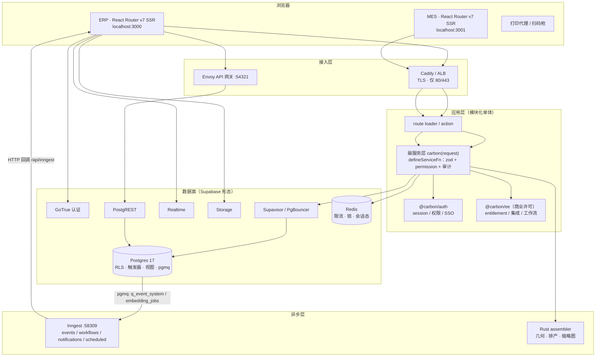
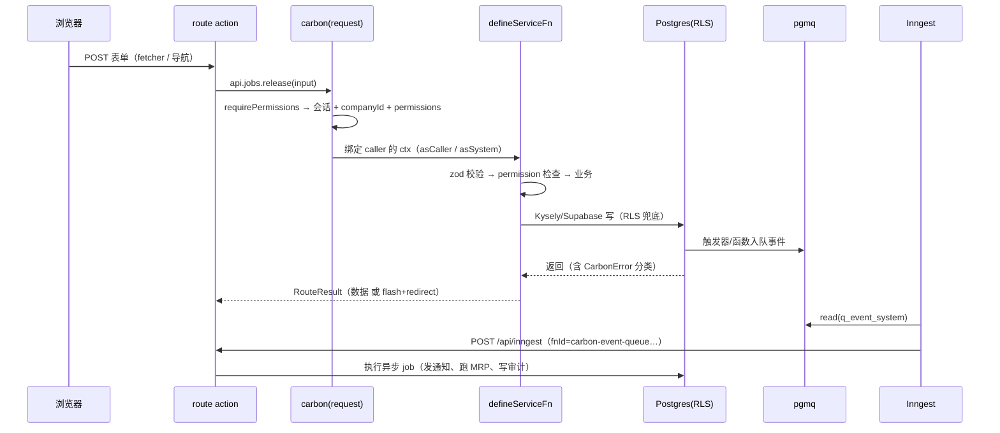
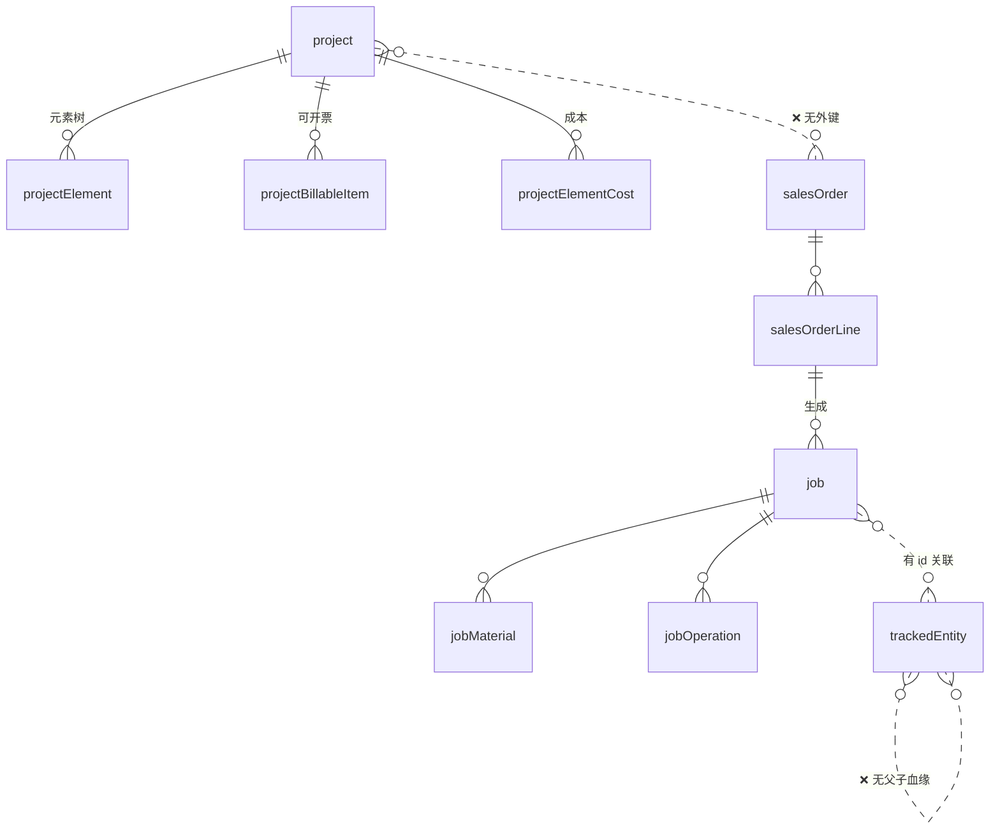
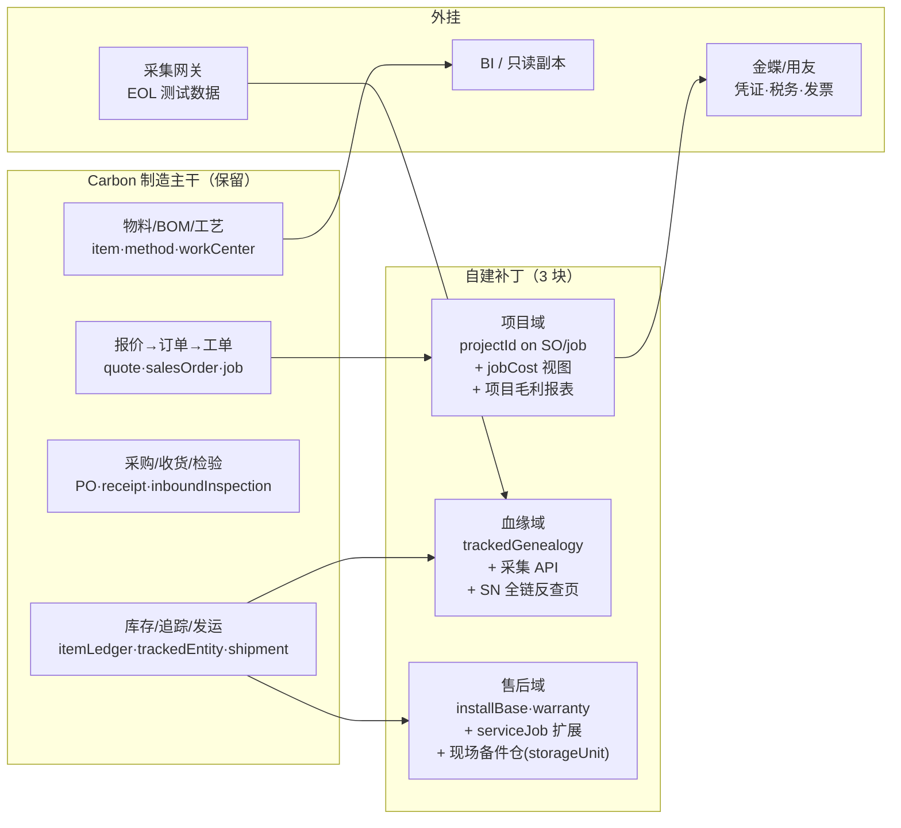

# Carbon 逆向蓝图方案

> **逆向依据**：`crbnos/carbon` 代码快照（main @ 2026-11-13，commit "fix(settings): write API keys only through the server"）、本地实际运行的库表结构、以及 `crbn up` 的启动链路。所有结论都标了代码/表名，可逐条核对。
> **用途**：给"系统集成 + 按项目交付"型储能企业做自有系统设计参考——哪些照抄、哪些改造、哪些外挂。
> **不做的事**：不评价厂商商业策略，不假设文档没写的 roadmap。

---

## 1. 一句话架构

**一个 Postgres 承载全部业务真相（权限、计算、事件、编号都在库里），一个 TypeScript 单体服务层（`defineServiceFn`）做用例编排，两个 React Router 前端（ERP/MES）共享同一套领域包，重活丢给 Inngest 和 Rust 边车。**

它不是微服务，是"模块化单体 + 数据库即平台"（database-as-a-platform）。这一点决定了它几乎所有优缺点。

---

## 2. 全景图



**部署三形态**（已确认）：本地 `crbn up`（Compose + 5 个共享容器 + 每 worktree 5 个容器）、单机 Swarm + Caddy（`contrib/deploying/simple-docker-caddy`）、AWS SST（`sst.config.ts`：Vpc + Cluster + 两个 ECS Service）。

---

## 3. 从代码反推的 6 条设计哲学

| # | 原则 | 证据 |
| --- | --- | --- |
| 1 | **权限是数据，不是代码** | `packages/database/src/authz/manifest.ts` 用 DSL 描述每张表的策略，`authz sync` 生成 RLS；`crbn up` 里有独立一步 "Sync RLS policies with the authz manifest" |
| 2 | **不变量放数据库** | 生成列算时间差、触发器写事件、`set_employee_pin` 校验 PIN 格式并 bcrypt、`verify_employee_pin` 在库内比对；`companySettings.consoleEnabled` 只允许服务端连接写（触发器拒绝 API 角色） |
| 3 | **用例收敛到一个函数形态** | `packages/api/src/service-fn.server.ts`：`defineServiceFn({ input: zod, permission, run })` + `CarbonError` 错误分类（`validation/forbidden/entitlement/conflict/rule/...` 映射 HTTP 400/403/402/409/422） |
| 4 | **前端只做两件事** | route 的 loader 读、action 写，都通过 `carbon(request)` 调服务函数；业务规则不在 route 里（`apps/*/app/routes` 里主要是编排与表单） |
| 5 | **异步靠 outbox，不靠双写** | 事务内写业务表 + 入 `pgmq`，`q_event_system`/`embedding_jobs` 由 Inngest 消费；Inngest 再回调应用 `/api/inngest` 执行具体 job（`packages/jobs/src/inngest/functions/{events,workflows,notifications,integrations,scheduled,tasks,extraction}`） |
| 6 | **商业功能物理隔离** | `packages/ee` + 任意 `*.ee.*` 文件走商业许可；entitlement 判断写在商业侧 `entitlements.server.ts`，注释明说"放在 AGPL 侧就是可删的 if" |

---

## 4. 仓库分层

| 层 | 目录 | 职责 |
| --- | --- | --- |
| 应用 | `apps/erp`、`apps/mes`、`apps/academy`、`apps/starter`、`apps/assembler`(Rust 服务) | 两个主应用共享 `packages/*`；MES 是独立部署单元 |
| 领域 | `packages/database`、`packages/accounting`、`packages/planning`（mrp/scheduling）、`packages/documents`、`packages/printing`、`packages/workflows-core`、`packages/notifications` | 数据模型、过账、MRP/排产、PDF/标签/ZPL、工作流引擎 |
| 平台 | `packages/api`、`packages/auth`、`packages/kv`、`packages/env`、`packages/logger`、`packages/query`、`packages/react`、`packages/form` | 服务函数框架、会话与权限、Redis、env schema、前端组件库 |
| 商业 | `packages/ee` | 集成（Jira/Linear/QuickBooks/Xero/Ramp/Sage/Slack/Onshape）、审批、控制台、审计、备份、AI、SSO、MCP、客户门户 |
| 工具链 | `packages/dev` | `crbn` CLI：worktree、Compose、端口、迁移、类型生成 |
| 原生 | `crates/{planner,collision,converter,occt-bridge,draco-bridge,optimize,thumbnail}` | 排产求解、碰撞、STEP/OCCT 几何、缩略图 |
| CI | `.github/workflows` ×10 | check / build-images / deploy / functions / database-types / post-deploy |

规模：31 packages、6 apps、7 crates、约 100 万行 TS/TSX、1,187 个测试文件、**1,467 条迁移**。

---

## 5. 运行时链路（一次写操作）



关键细节（都可直接复用）：

- **双客户端**：`ctx.asCaller.supabase`（走 RLS，代表用户）与 `ctx.asSystem.pg`（Kysely 直连，绕过 RLS，仅服务端）。凡是"RLS 挡住会导致功能不可用"的读，才用 system。
- **审计与 actor**：`ctx.auditUserId` 与 `ctx.actor.type`（user/system/portal），审计日志单独走 EE 的 `audit`。
- **错误即返回值**：`ctx.error("entitlement", ...)` → HTTP 402，前端统一 toast，不需要 try/catch 满天飞。

---

## 6. 数据面蓝图

### 6.1 领域分族（544 张表，按前缀归族）

| 族 | 代表表 | 说明 |
| --- | --- | --- |
| 主数据 | `item` `itemCost` `method`/`makeMethod` `workCenter` `location` `storageUnit` `customer` `supplier` | 物料/BOM/工艺路线/工作中心/库位 |
| 销售 | `quote` `salesOrder` `salesOrderLine` `shipment` `salesInvoice` | 报价→订单→发运→开票 |
| 采购 | `supplierQuote` `purchaseOrder` `receipt` `purchaseInvoice` | 含长交期、收货检验联动 |
| 制造 | `job` `jobMaterial` `jobOperation` `jobMakeMethod` `jobMaterialTracking` | 每单一个 job，展开成工单树 |
| 库存 | `itemLedger` `trackedEntity` `batchNumber` `serialNumber` `trackedActivity` | 台账 + 追踪实体 + 活动流 |
| 质量 | `inboundInspection`(+Feature/Measurement/History) `nonConformance` `changeOrder` | 来料/过程检验、不良、变更 |
| 项目 | `project` `projectElement` `projectMilestone` `projectBillableItem` `projectElementCost` `projectLedger` | 项目会计（元素树 + 里程碑 + 可开票项 + 成本） |
| 服务 | `serviceJob` `serviceJobAssignment` `maintenanceDispatch` | 现场派工、设备维保 |
| 会计 | `account` `journal` `costLedger` `costCenter` `currency` `exchangeRate` `customerTax` `supplierTax` | 总账/成本/币种/税 |
| 平台 | `user` `employee` `employeeTypePermission` `companySettings` `sequence` `auditLog` `workflow*` | 权限、编号、设置、审计、工作流 |

### 6.2 三个"看起来有、其实要补"的地方（对你的业务最致命）



1. **`job` 没有 `projectId`**（有 `salesOrderId/quoteId/modelUploadId/configuration`），`project` 也没有 `salesOrderId`。项目会计模块与制造引擎是两个世界。
2. **`trackedEntity` 没有 parent/child**，只有 `attributes` JSONB + `trackedActivity`。多级血缘必须自建。
3. **无 `warranty` / `installBase`**：装机台账与质保是空白，`serviceJob` 只是派工壳。

---

## 7. 五个核心机制逆向（可直接抄的部分）

### 7.1 权限：manifest → RLS

```ts
// packages/database/src/authz/manifest.ts（反向阅读）
policies("job", {
  read:   member("view")(...),
  write:  custom((ctx) => ...),
  portal: portal(...)  // 客户门户只看自己的
})
```

- 规则 DSL：`member/owner/company/group/portal/through/viaParent/exists/anyOf/...`。
- `authz sync` 让**数据库向代码对齐**；`authz migration` 把变更发给未同步的库（客户环境）。
- 好处：权限只有一处事实来源；坏处：策略生成器本身要有测试（他们确实有 `manifest.test.ts` / `rules.test.ts`）。

### 7.2 单据编号：`sequence` 表

- 每张单据一张 sequence 行：`prefix/suffix/size/step/next`，支持 `%{yyyy} %{mm} %{ww} %{dd}` 令牌，**按公司维度、按公司本地午夜滚动**。
- 原子性：`UPDATE ... SET next = next + step*n RETURNING`，靠行锁避免并发撞号。
- 对比：比 `serial`/`nextval` 更适合多租户 + 可配置前缀（每个客户要自己的单号规则）。

### 7.3 事件：pgmq + Inngest 的 outbox

- 表级触发器把变更写入 `pgmq.q_event_system`；`event-queue-wake` 迁移里有 `vt <= clock_timestamp()` 的唤醒逻辑。
- Inngest 按命名空间分：`events`（事件消费）、`workflows`（用户配置的工作流）、`notifications`、`integrations`、`scheduled`（mrp-companies、dispatch、cleanup、audit-archive…）、`tasks`、`extraction`（文档抽取）。
- 应用侧只暴露一个 `/api/inngest`，Inngest 反向回调执行 job —— **任务代码留在应用里，编排在 Inngest**。

### 7.4 服务函数：一个形状统管所有用例

```ts
export const releaseJob = defineServiceFn({
  input: z.object({ jobId: z.string() }),
  permission: { update: "production" },
  async run(ctx, { jobId }) { /* ctx.asCaller / ctx.asSystem / ctx.auditUserId */ }
});
```

- 输入 zod、权限声明、错误分类（402 entitlement 很关键）、审计 actor —— 四件事一次定义，route 只调用。
- 前端拿 `RouteResult`：`{ data }` 或 flash+redirect，表单错误自动回填。

### 7.5 追踪实体：一张表管所有序列化/批次

`trackedEntity(quantity, status, attributes, sourceDocument, sourceDocumentId)` + `trackedActivity` + 关联表（`jobOperationTrackedEntity`、`inspectionTrackedEntity`、`nonConformanceItemTrackedEntity`、`maintenanceDispatchItemTrackedEntity`）。

**优点**：不用给 20 张表各加 serial 字段，检验/不良/维修天然能引用同一个实体。
**缺口**：没有血缘。补法是新增一张 `trackedGenealogy(parentId, childId, qty, opId)`，在装配报工时写入——**这是你这个行业必须补的第一张表**。

---

## 8. 多租户与安全

| 维度 | 做法 |
| --- | --- |
| 租户 | 每表 `companyId`；`companyGroup` 做集团；`TENANT_TYPE=single`（自托管，一家公司）vs `multi`（Cloud） |
| 授权 | RLS 兜底 + 服务层 `permission` 双保险；`portal` 角色（客户/供应商外部用户）单独策略 |
| 会话 | GoTrue 签发的 `carbon` HttpOnly cookie；`requirePermissions` 解析出 `userId/companyId/permissions` |
| 危险动作 | 只允许服务端直连（`companySettings.consoleEnabled`、`employeePin` 表无 API 权限、密码哈希） |
| 限流/锁定 | Redis：`Ratelimit`（滑动窗口）+ `AccountLockout`（指数退避），登录与 console PIN 都两层（按人 + 按终端） |
| 受控环境 | `CONTROLLED_ENVIRONMENT`（ITAR）→ 会话锁、实名、审计；SSO/2FA 在 EE |

---

## 9. 扩展点（不动核心就能加能力的地方）

1. **工作流引擎**：`workflows-core`（moments/run-trigger）+ 可视化编辑；步骤可跨系统（Gmail/Slack/Calendar 在 EE）。
2. **集成层**：每个集成一个 `packages/ee/src/<name>`，统一 OAuth 连接表 `integrationConnection`。
3. **MCP / 公共 API**：`/api/mcp` 把 ERP 动作暴露给 AI Agent（受 entitlement `MCP` 控制）；`/api/v1` REST。
4. **Webhook**：出站 webhook + 入站（`api/webhook.*.$companyId.ts` 很多，按供应商定制）。
5. **打印/标签**：`packages/printing`（模板 + 队列 + 代理）+ `packages/documents/{pdf,labels,zpl,qr}`。
6. **模型/几何**：`modelUploadId` 挂 STEP；`crates/*` 做 OCCT 转换、碰撞、缩略图；`assembler` 服务做 /convert /plan。
7. **自定义字段**：`customFields` JSONB + `customField` 定义表，不用改 schema。

---

## 10. EE 边界（照抄时要绕开的坑）

- 物理边界：`packages/ee` + `*.ee.*`；`entitlements.server.ts` 里的 `requireEntitlement` 是**唯一**的锁，`companyHasFeature` 是唯一事实来源。
- 判定：`Community → false`；`Cloud → 按 plan`；`Enterprise/Test 自托管 → true`（`companyHasPlan` 里 `CarbonEdition !== Cloud` 直接 true）。
- 所以 `CARBON_EDITION=enterprise` 是**软开关**，没有 license key（代码注释自认是 future work）。
- **给我们的启示**：如果你的产品要卖商业版，别抄这个软开关；要么签名 license（ed25519 + 机器绑定 + 到期），要么把商业能力做成独立服务。

---

## 11. 部署与运维蓝图

| 形态 | 组成 | 适用 |
| --- | --- | --- |
| 本地 | `crbn up`：Compose，共享容器（Postgres/PgBouncer/Storage/Imgproxy/Inbucket/Redis/Edge）+ 每 worktree 5 容器（envoy/gotrue/postgrest/realtime/inngest），Vite dev server | 开发、PoC |
| 单机自托管 | Docker Swarm + Caddy（80/443）+ secrets + `deploy.sh init/up/migrate`；Postgres 17、Supavisor、Studio 可选 | 中小客户、内网 |
| 云 | SST：Vpc + ECS Cluster + 两个 Service（ERP/MES）+ 托管 PG/Redis | 多租户 SaaS |

运维要点（从脚本反推）：迁移在应用启动时串行执行（`supabase/migrations` + `scripts`）；备份 `backup.sh`（pg_dump + storage 归档）；升级 `git pull && deploy.sh init && deploy.sh up`；健康检查 `/health`；升级需注意 Postgres 15→17 的卷不兼容（官方给了迁移步骤）。

---

## 12. 给"储能系统集成 + 按项目交付"的落地蓝图

### 12.1 目标架构（Carbon 当制造主干，四周补三块，财务外挂）



### 12.2 补丁一：项目维度（P0，1 人月）

```sql
-- 1) 打通
ALTER TABLE "salesOrder" ADD COLUMN "projectId" text REFERENCES project(id);
ALTER TABLE "job"        ADD COLUMN "projectId" text REFERENCES project(id);
-- 2) 成本归集视图（材料走 itemLedger，工时走 jobOperation × 费率）
CREATE VIEW "jobCost" AS
SELECT j.id AS "jobId", j."projectId", j."companyId",
       COALESCE(mat.amount, 0)  AS "materialCost",
       COALESCE(lab.amount, 0)  AS "laborCost"
FROM job j
LEFT JOIN (/* jobMaterial 出库金额汇总 */) mat ON mat."jobId" = j.id
LEFT JOIN (/* jobOperation 实际工时 × workCenter 费率 */) lab ON lab."jobId" = j.id;
-- 3) 项目毛利 = 项目可开票(projectBillableItem) − Σ jobCost − 外协/运费
```

**三种建模对比**：加列（推荐，长期）／`customFields` + 视图（2 人周，先验证）／一个订单当项目（0 成本，多设备项目会崩）。

### 12.3 补丁二：电芯→模组→簇→柜 血缘（P1，2–4 人周）

```sql
CREATE TABLE "trackedGenealogy" (
  id text PRIMARY KEY DEFAULT xid(),
  "companyId" text NOT NULL,
  "parentEntityId" text NOT NULL REFERENCES "trackedEntity"(id),
  "childEntityId"  text NOT NULL REFERENCES "trackedEntity"(id),
  quantity numeric NOT NULL,
  "jobOperationId" text REFERENCES "jobOperation"(id),
  "createdAt" timestamptz NOT NULL DEFAULT now()
);
CREATE INDEX ON "trackedGenealogy" ("childEntityId");
CREATE INDEX ON "trackedGenealogy" ("parentEntityId");
```

写入时机：装配报工（`jobOperation` 完成）时，按投入的 child SN 与产出的 parent SN 建边。
读取：递归 CTE 反查（向上到电芯批次、向下到集装箱/站点），配一个 `/x/trace/:sn` 页面 + 导出 CSV 给认证/索赔用。

### 12.4 补丁三：装机台账 + 质保（P2，1–2 人月）

`installBase`（站点、并网日期、SN 清单、客户）→ `warranty`（SN 级起止、条款、延保）→ `serviceJob`（故障码、备件消耗、SLA 计时）。现场备件用 `storageUnit` 建"项目现场仓"，发运即调拨。

### 12.5 财务边界（P2，接口 2–3 人周）

数据流单向：Carbon → 金蝶（或中间库）
- 库存/成本：`itemLedger` + `jobCost` 按期间汇总 → 凭证；
- 销售：`salesInvoice`（不含税）→ 应收；
- 采购：`purchaseInvoice` → 应付；
- **发票/税/报关不进 Carbon**，避免为它重写税务层。

### 12.6 90 天路线

| 阶段 | 周 | 交付 | 验收标准 |
| --- | --- | --- | --- |
| P0 | 1–3 | 主数据 + 一条真实项目（电芯/PCS 采购 → 簇/柜工单 → 检验 → 发运） | BOM 与 `configuration` 能表达机柜选型；工单能拆到工序 |
| P1 | 4–6 | 血缘表 + 采集接口 + 反查页 | 任取集装箱 SN，反查到电芯批次与全部检验记录，<5s |
| P2 | 7–10 | `projectId` 打通 + `jobCost` + 项目毛利 + 里程碑开票 | 单项目毛利与手工 Excel 偏差 <2% |
| P3 | 11–13 | 装机台账 + 质保 + 派工 + 金蝶接口 | 售后可开单，财务可对账 |

---

## 13. 可以直接抄的 12 个模式

1. **RLS 由 manifest 生成**（单一事实来源），而不是散落的手写 policy。
2. **服务函数三件套**：zod 输入 + 权限声明 + 错误分类（`402 entitlement` 这种语义化状态码很好用）。
3. **outbox 事件**：业务事务内入 `pgmq`，外部消费者（Inngest）出队执行，杜绝双写不一致。
4. **`sequence` 表做单号**：可配置前后缀、按公司、按本地午夜滚动、行锁防撞号。
5. **双 ID**：`xid()` 短 ID 做外键 + 可读单号（`jobId`）做人类标识。
6. **一张 `trackedEntity` 管所有序列化**，检验/不良/维修都引用同一实体。
7. **`customFields` JSONB + 字段定义表**：客户定制不改 schema。
8. **ERP/MES 共享库与领域包**，只在部署与 UI 上分开——比"两套库 + 同步"便宜一个数量级。
9. **打印/标签独立成包**（模板 + 队列 + ZPL），现场打印机不是应用的耦合点。
10. **排产/几何用 Rust 边车**（`crates/planner` + `assembler` 服务），主栈不被数值计算拖慢。
11. **每个 worktree 一套隔离栈**（`crbn`）：端口、库、Redis db、JWT 都按 worktree 分配——多分支并行开发的关键。
12. **商业能力物理隔离 + 服务侧 entitlement 检查**（照抄结构，但别照抄软开关）。

## 14. 不要照抄的地方

| 反模式 | 原因 | 你的做法 |
| --- | --- | --- |
| 1,467 条迁移、两周一个版本、无 LTS | 对他们有利（快），对自托管客户是升级地狱 | 版本化 + 每季度 squash + 兼容性测试 |
| `CARBON_EDITION=enterprise` 即全开 | 授权靠合同不靠技术 | 签名 license / 独立商业服务 |
| 项目模块与制造引擎互不相通 | 这是他们自己的历史债 | 第一天就把 `projectId` 放进订单与工单 |
| 追踪实体没有血缘 | 制造业追溯的硬需求 | 血缘表作为一等公民 |
| 财务/税务指望 ERP 全包 | 中国财税复杂度被低估 | 明确"制造在 A、账在 B"的边界 |
| 单库多租户 + RLS 跑跨公司聚合报表 | RLS 过滤 + 大聚合 = 慢 | 报表走只读副本 / 物化视图，绕开 RLS |
| 把 EE 的 entitlement 当作"以后再加" | 功能先发布后收费，回填极痛 | 发布前就把 entitlement 插在服务边界 |

## 15. 复核清单（给评审会用的 10 个问题）

1. `job` 与 `project` 的关系，我们采用哪种？谁拥有 `projectId` 的写入权？
2. 一个项目多台设备时，发运单、发票、质保的粒度是"项目"还是"SN"？
3. 电芯批次与模组 SN 的绑定发生在哪个工序？谁负责扫？
4. EOL 测试数据的来源（设备型号/协议）？失败品如何回到 NCR？
5. 现场备件仓的库存所有权：公司资产还是项目成本？
6. 项目变更（`changeOrder`）如何影响已释放工单与已开票金额？
7. 里程碑开票与收入确认的规则，谁签字？
8. 金蝶接口的对账频率与差异处理人？
9. 升级策略：跟上游两周节奏，还是锁 fork？谁维护？
10. 数据主权与许可：AGPL 网络条款是否影响我们对外提供 SaaS？

---

### 附录 A：本次逆向用到的验证命令

```bash
# 表清单
docker exec -i carbon-postgres psql -U postgres -d wt_carbon -c "\dt" | wc -l
# 关键关系（确认 job 没有 projectId）
docker exec -i carbon-postgres psql -U postgres -d wt_carbon -c "\d job" | grep -i project
# 权限事实来源
sed -n '1,60p' packages/database/src/authz/manifest.ts
# 追踪实体
sed -n '1,40p' packages/database/supabase/migrations/20250225145619_tracked-entities.sql
# 事件队列
grep -n "q_event_system" packages/database/supabase/migrations/*.sql | head
```

### 附录 B：术语对照

| Carbon 术语 | 含义 |
| --- | --- |
| `job` | 工单（一个制造任务） |
| `method` / `makeMethod` | 工艺路线 / 制造 BOM 展开 |
| `trackedEntity` | 可追踪实体（序列号或批次实例） |
| `nonConformance` | 不合格品记录（含处置动作） |
| `projectElement` | 项目元素（WBS 节点） |
| `carbon(request)` | 绑定当前调用者的服务函数树 |
| EE | `packages/ee`，商业许可功能 |
