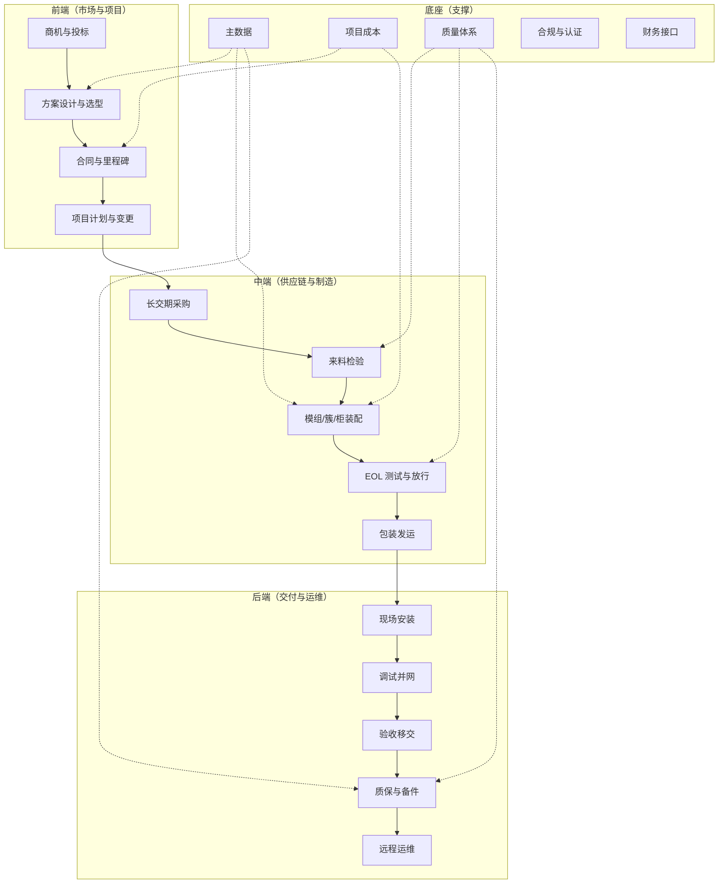
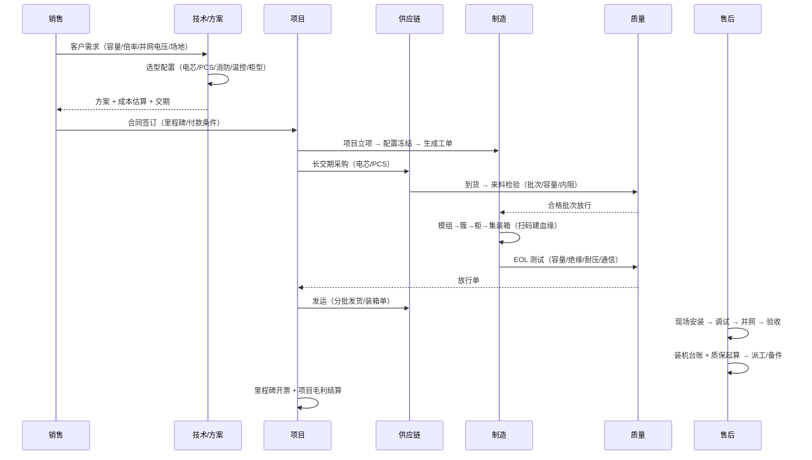
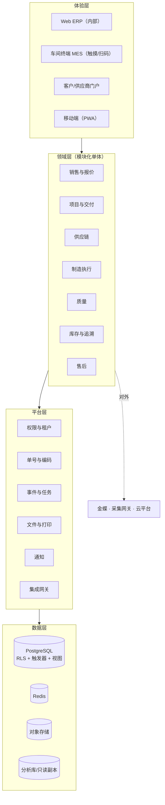
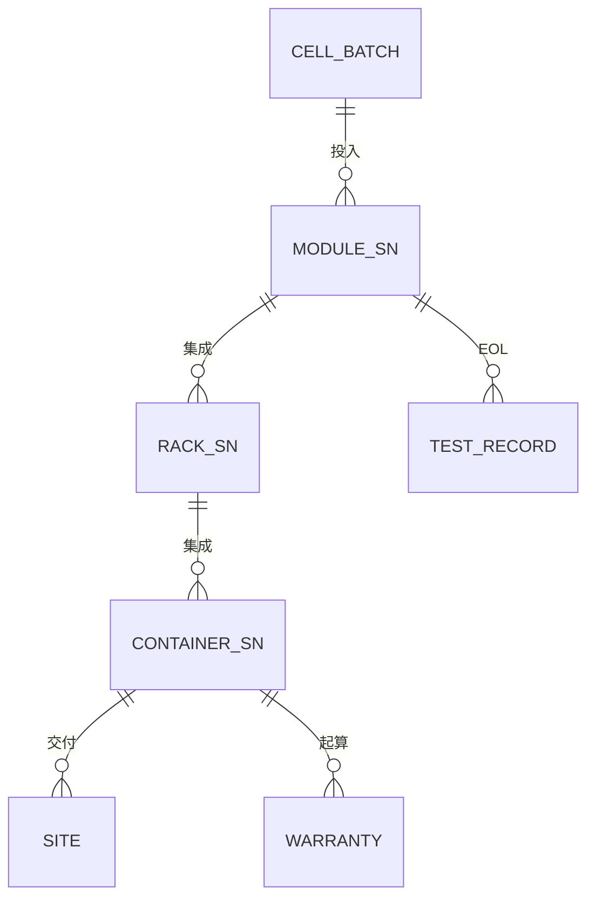

# 系统集成 + 按项目交付型储能企业 · 数字化蓝图方案

> **主体**：以"外购电芯/PCS/消防/温控，自主完成模组—簇—机柜—集装箱集成，按项目交付并承担现场调试与质保"的工商储能（C&I BESS）企业为蓝本。
> **来源**：以 `crbnos/carbon`（制造主干）为参照系逆向设计，结合其已验证的表结构与机制。Carbon 的代码级逆向见 [carbon-蓝图方案.md](carbon-蓝图方案.md)。
> **性质**：To-Be 蓝图 + 选型取舍，可直接作为立项/评审材料。文中对产能、项目数的描述为占位参数，按实际替换。

---

## 0. 蓝图的三条主线

这类企业同时跑三条链，**任何一套系统只要把其中一条做成二等公民，项目就会散落到 Excel**：

| 链 | 起点 | 终点 | 系统承载的核心对象 |
| --- | --- | --- | --- |
| **项目交付链** | 商机/投标 | 并网验收 + 移交运维 | 项目、合同、里程碑、变更、验收单 |
| **制造链** | 项目配置确认 | 集装箱发运 | 配置、BOM、工单、工序、检验、追踪 |
| **售后链** | 并网 | 质保到期/延保 | 装机台账、SN、工单、备件、SLA |

三条链共用同一套主数据（物料、客户、供应商、库位、SN），**共用一套 SN 血缘**。这是蓝图的第一原则。

---

## 1. 业务蓝图

### 1.1 业务能力地图

**能力成熟度现状 vs 目标**：

| 能力 | 典型现状 | 目标（本项目） | 优先级 |
| --- | --- | --- | --- |
| 方案/选型 | Excel + CAD，选型靠人 | 配置化选型（参数→BOM 变体） | P1 |
| 项目计划 | 甘特图单机文件 | 里程碑 + 关键路径 + 变更留痕 | P1 |
| 长交期采购 | 邮件+微信跟单 | MRP 建议 + 到货预测 + 齐套检查 | P0 |
| 装配执行 | 纸质派工/工位白板 | 工单+工序+扫码报工 | P0 |
| 检验 | 纸质 EOL 报告 | 检验计划 + 测量值 + 不合格隔离 | P0 |
| 追溯 | 批次台账 Excel | SN 多级血缘（电芯→模组→簇→柜→站点） | P0 |
| 项目成本 | 月末手工归集 | 工单级实时归集 + 项目毛利 | P2 |
| 售后 | 客服台账 | 装机台账 + 质保 + 派工 + 备件 | P2 |
| 财务 | 金蝶/用友 | 保持外挂，只做接口 | 不替换 |

### 1.2 端到端主流程（L1）

### 1.3 五个必须写进制度的业务规则

| # | 规则 | 为什么关键 | 系统落点 |
| --- | --- | --- | --- |
| R1 | **配置冻结**：项目进入制造前，选型配置锁定，变更走变更单 | 否则 BOM/工单/采购全乱 | 订单行 + 配置快照 + `changeOrder` |
| R2 | **SN 即出生证**：模组/簇/柜在生产时生成 SN，且绑定下级 SN | 质保索赔与召回的唯一定位手段 | `trackedEntity` + `trackedGenealogy` |
| R3 | **不合格隔离**：来料/过程/EOL 不合格必须进 NCR，禁止直接回线 | 储能安全事故的根因多为"带病放行" | `nonConformance` + 状态机 |
| R4 | **齐套才能开工**：长交期物料齐套检查通过才释放工单 | 现场装配停线成本最高 | MRP + 齐套视图 + 释放校验 |
| R5 | **里程碑开票与收入确认分离**：开票看合同，收入看交付 | 财税合规与项目现金流 | 项目里程碑 + 可开票项 + 财务接口 |

### 1.4 组织与角色（RACI 摘要）

| 活动 | 销售 | 方案 | 项目 | 供应链 | 制造 | 质量 | 售后 | 财务 |
| --- | --- | --- | --- | --- | --- | --- | --- | --- |
| 选型配置 | C | **R** | C | I | I | C | I | I |
| 合同/里程碑 | **R** | C | C | I | I | I | I | A |
| 配置冻结 | I | **R** | A | C | C | C | I | I |
| 采购与齐套 | I | C | A | **R** | C | I | I | I |
| 装配与追溯 | I | I | A | C | **R** | C | I | I |
| EOL 放行 | I | I | A | I | C | **R** | I | I |
| 现场交付 | I | C | **R** | I | C | C | A | I |
| 质保/派工 | I | I | C | C | I | C | **R** | I |
| 项目核算 | I | I | C | C | C | I | I | **R** |

---

## 2. 应用蓝图

### 2.1 分层

### 2.2 十二个应用域的取舍（复用 Carbon / 配置 / 二开 / 外挂）

| # | 域 | 核心功能 | 复用度 | 动作 |
| --- | --- | --- | --- | --- |
| 1 | 主数据 | 物料/BOM/工艺/客户/供应商/库位 | 高 | 直接复用（Carbon `item`/`method`/`workCenter`） |
| 2 | 报价与选型 | 报价单、配置、版本 | 中 | 复用 `quote` + 自建配置器（参数→BOM） |
| 3 | 项目与交付 | 立项、WBS、里程碑、验收 | 中 | 复用 `project*`，补"项目↔订单/工单"外键 |
| 4 | 供应链 | 询价、PO、收货、齐套 | 高 | 直接复用（`supplierQuote`/`purchaseOrder`/`receipt`） |
| 5 | 制造执行 | 工单、工序、报工、扫码 | 高 | 直接复用（`job`/`jobOperation`/`jobMaterial`） |
| 6 | 质量 | 检验计划、测量值、NCR | 高 | 复用 + 扩展 EOL 测试项模板 |
| 7 | 库存与追溯 | 台账、批次、SN、调拨 | 中 | 复用 `trackedEntity`，**自建 `trackedGenealogy`** |
| 8 | 发运 | 分批发运、装箱、标签 | 中高 | 复用 `shipment` + ZPL 标签；报关单证外挂 |
| 9 | 售后 | 装机、质保、派工、备件 | 低 | **自建** `installBase`/`warranty`，复用 `serviceJob` |
| 10 | 成本与财务 | 成本归集、开票、总账 | 低 | 成本自建视图；**总账外挂金蝶** |
| 11 | 报表分析 | 项目毛利、产能、质量 | 中 | 只读副本 + BI（绕开 RLS） |
| 12 | 集成 | 采集、财务、IoT | 低 | 自建采集网关 + 接口表 |

### 2.3 集成蓝图（接口清单）

| 接口 | 方向 | 内容 | 频率 | 协议 | Owner |
| --- | --- | --- | --- | --- | --- |
| 财务凭证 | 本系统 → 金蝶 | 库存/成本/应收应付汇总 | 按日/按期间 | 中间表或 API | 财务 IT |
| 销项发票 | 本系统 → 金税/发票平台 | 开票申请（含项目、SN） | 事件触发 | 发票平台 API | 财务 IT |
| EOL 测试数据 | 采集网关 → 本系统 | 容量/内阻/绝缘/耐压/通信 | 实时 | HTTP（MQTT 可选） | 制造 IT |
| 设备运行数据 | 储能云平台 → 本系统 | 告警/健康度（售后用） | 小时级 | API | 售后 IT |
| 条码打印 | 本系统 → 打印代理 | 标签/装箱单 | 实时 | 队列 | 制造 IT |
| 客户门户 | 客户 → 本系统 | 交付进度/质保工单 | 实时 | Web | 售后 |

**接口纪律**：所有跨系统写操作幂等（带业务唯一键），失败进死信表可重放；禁止"双向同步同一字段"。

---

## 3. 数据蓝图

### 3.1 主数据与编码

| 对象 | 编码规则（建议） | 唯一性 | 备注 |
| --- | --- | --- | --- |
| 物料 | 分类码 + 流水（`BAT-CELL-0001`） | 全局 | 电芯按厂商料号映射 |
| 项目 | `PJ-{yyyy}-{seq}` | 全局 | 与合同号双向可查 |
| 订单/工单 | `SO-`/`JO-{yyyyMM}-{seq}` | 公司内 | 按公司维度、本地午夜滚动 |
| 模组/簇/柜/箱 | 结构码 + 日期 + 流水（`PK-YYMMDD-0001`） | 全局 | SN 一旦生成不可改 |
| 批次 | 供应商批次 + 内部批次双写 | 物料内 | 电芯必须双写 |

### 3.2 追溯链（本方案的硬核心）

- 边（投入关系）在**装配报工**时写入，带 `jobOperationId`、数量、操作人、时间。
- 反查两个方向：向上（这个集装箱用了哪些电芯批次）、向下（这批电芯去了哪些项目）。
- 保留期：质保期 + 法规要求（建议 ≥10 年），归档到冷存储。

### 3.3 数据治理三条铁律

1. **单一来源**：SN 只在生产系统生成；金蝶不建 SN；采集网关不回写主数据。
2. **不可变事实**：台账/血缘/检验记录只追加，更正用冲销/新版本，不 update。
3. **口径唯一**：项目毛利只有一个视图（`jobCost` + 可开票项），禁止各报表各自算。

---

## 4. 技术蓝图

### 4.1 选型（附理由）

| 层 | 选型 | 理由（逆向自 Carbon 的验证） |
| --- | --- | --- |
| 数据库 | PostgreSQL + RLS + 触发器 + 视图 | 权限/租户/不变量在库内一次写好，应用层不用"记得加 where" |
| 后端 | TypeScript 模块化单体（服务函数形态） | 单人可维护；`zod 输入 + 权限声明 + 错误分类` 三件套收敛所有用例 |
| 前端 | React Router SSR + 组件库 | 内部系统 SEO 不重要，但 SSR 首屏与表单动作很省事 |
| 异步 | outbox + 队列 + 工作流引擎 | 业务事务内入队，外部消费；避免双写 |
| 数值/排产 | Rust 边车 | 排产求解与几何处理不拖慢主栈 |
| 缓存/锁 | Redis | 限流、锁、幂等键 |
| 文件 | 对象存储 + 预签名 URL | 图纸/报告/照片体量大 |
| 分析 | 只读副本 + BI | 绕开 RLS，避免大聚合拖垮主库 |

### 4.2 部署与容量

| 项 | 建议 |
| --- | --- |
| 形态 | 私有云/机房单集群起步（K8s 或 Compose+Swarm），ERP 与 MES 分开扩缩 |
| 最小规格 | 应用 4C8G ×2、Postgres 8C16G + SSD 500G、Redis 2G |
| 高可用 | Postgres 主备 + WAL 归档；应用无状态多副本；对象存储多副本 |
| 备份 | 全备日备 + WAL 连续归档；**RPO ≤ 15min，RTO ≤ 4h**；每季度演练恢复 |
| 环境 | dev / test / prod 三套；test 用生产脱敏数据，禁止直连生产 |
| 升级 | 版本化发布 + 迁移前自动备份 + 回滚脚本；**不跟上游两周节奏，按季度发版** |

### 4.3 安全与合规

- **权限模型**：角色（岗位）→ 模块权限（增删改查）→ 数据范围（公司/项目/仓库）；权限策略由清单生成，不手写 SQL。
- **审计**：所有单据状态变更、权限变更、导出行为留痕，保留 ≥3 年。
- **认证**：账号 + 强密码 + 可选 SSO；车间终端用 PIN 换人（不共享账号）。
- **数据出境**：若出口业务涉及境外客户/运维，先做数据分级，运行数据默认不出境。
- **认证体系映射**：UL9540 / GB 36276 / IEC 62619 的过程记录（检验、放行、变更）直接由系统出证，减少审核时补材料。

---

## 5. 实施蓝图

### 5.1 分期与验收

| 期 | 周期 | 范围 | 验收标准（可量化） |
| --- | --- | --- | --- |
| P0 | 第 1–3 月 | 主数据 + 一个真实项目全链（配置→采购→工单→检验→发运） | 该项目 BOM/工单/检验数据 100% 系统内；齐套率可查 |
| P1 | 第 4–6 月 | 追溯（血缘 + 采集接口）+ 质量闭环 | 任取集装箱 SN，5 秒内反查全部下级与检验记录 |
| P2 | 第 7–9 月 | 项目成本 + 里程碑开票 + 财务接口 | 单项目毛利与手工核算偏差 <2%；凭证日清 |
| P3 | 第 10–12 月 | 售后（装机/质保/派工/备件）+ 客户门户 | 质保工单响应 <4h；备件账实一致 |

### 5.2 团队与工作量

| 角色 | 人数 | 说明 |
| --- | --- | --- |
| 项目经理/业务架构 | 1 | 全流程 owner，管 R1–R5 规则落地 |
| 后端（TS/SQL） | 2 | 服务函数、项目域、血缘、接口 |
| 前端 | 1–2 | ERP 页面、MES 终端、报表 |
| 数据/集成 | 1 | 金蝶接口、采集网关、BI |
| 实施/培训 | 1 | 主数据清洗、SOP、上线陪跑 |
| **合计** | **6–7 人 · 约 40 人月**（首年） | 不含厂商许可与硬件 |

### 5.3 KPI（上线后 6 个月目标）

| 指标 | 现状（典型） | 目标 |
| --- | --- | --- |
| 齐套率（开工前） | 无法统计 | ≥95% |
| 一次检验合格率 | 靠台账 | 可统计，且 EOL 数据自动入库 |
| 追溯定位时间 | 数小时~数天 | <5 分钟（任取 SN） |
| 项目毛利偏差 | 月末才知道 | 周级可见，偏差 <2% |
| 质保响应 | 靠人记 | 工单化，4h 首响 |

### 5.4 风险登记册

| 风险 | 影响 | 概率 | 缓解 |
| --- | --- | --- | --- |
| 配置化选型做不出来，退回人肉 | 高 | 中 | P0 先用"配置模板 + 人工确认"，P2 再上规则引擎 |
| 电芯供应商批次数据不齐 | 高 | 高 | 收货即建批次，缺失字段标"未知"并在 NCR 中跟踪 |
| 现场网络差，MES 不可用 | 中 | 中 | MES 支持离线队列（扫码缓存，恢复后补传） |
| 财务坚持"一套系统" | 高 | 中 | 用接口成本对比说明：重写税务层 ≥12 人月且持续维护 |
| 关键人依赖 | 中 | 高 | 规则 R1–R5 写成 SOP，代码评审强制 |
| 升级失控 | 中 | 中 | 锁版本 + 季度发版 + 迁移演练 |

---

## 6. Carbon 复用矩阵（结论）

| 能力 | 结论 | 说明 |
| --- | --- | --- |
| 物料/BOM/工艺/工单/报工 | **直接复用** | 模型成熟，是最省时间的部分 |
| 采购/收货/检验/NCR | **直接复用** | 只需扩展 EOL 检验模板 |
| 序列号/批次追踪 | **复用骨架 + 自建血缘** | `trackedEntity` 没有父子关系，必须补 `trackedGenealogy` |
| 项目/里程碑/开票 | **复用骨架 + 打通外键** | `project` 与订单/工单无关联，需加 `projectId` |
| 成本归集 | **自建视图** | 库里有 `itemCost`/`projectElementCost`，但不由工单驱动 |
| 售后/质保 | **自建** | 无 `installBase`/`warranty` |
| 财务/税务 | **外挂** | 中美会计结构差异，重写不划算 |
| SSO/审批/工作流/门户 | **按需买 EE** | 商业许可，需预算 |

一句话结论：**用它当"制造 + 质量 + 追溯"的骨架，省掉 60% 的基础工作量；项目维度、血缘、售后三块自己补，财务外挂。总投入约 40 人月/首年，其中二开约 12 人月。**

---

## 7. 架构决策记录（ADR）

| ID | 决策 | 备选 | 理由 |
| --- | --- | --- | --- |
| ADR-01 | 单库多租户 + RLS | 每客户一库 | 运维成本与升级一致性；报表走只读副本弥补 |
| ADR-02 | 项目维度加外键（订单/工单带 `projectId`） | 用订单当项目 / 自定义字段 | 多设备项目必须合并核算；自定义字段无法约束 |
| ADR-03 | 血缘表作为一等公民 | 用属性 JSON 拼 | 追溯是认证与索赔的硬需求，JSON 查询不可控 |
| ADR-04 | 财务外挂金蝶 | 自建总账 | 中国税务复杂度高，重写 ≥12 人月且长期维护 |
| ADR-05 | 模块化单体，不上微服务 | 微服务 | 团队 6–7 人，微服务的分布式成本远超收益 |
| ADR-06 | 版本化发布（季度） | 跟随上游节奏 | 制造业客户不能每两周停机升级 |

---

## 8. 下一步（两周内可完成）

1. 用真实项目做**配置表达力测试**：把一套机柜的选型参数与 BOM 变体录进去，看能否用"参数 + 规则"生成，而不是每个项目建一套 BOM。
2. 定义 **SN 编码规则与血缘写入点**（哪道工序扫哪个码），这是 P1 的前提。
3. 与财务确认**接口口径**：按期间汇总还是逐单，差异谁处理。
4. 立项评审：把本蓝图的 ADR-01～06 作为评审输入，逐条签字。
